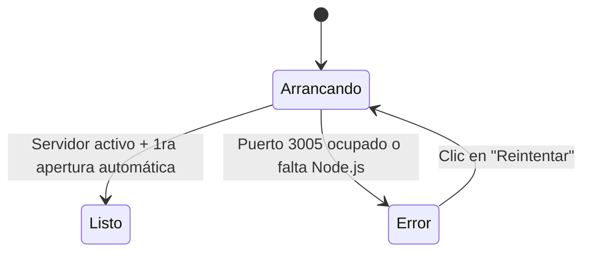

# Arquitectura y Diseño del Launcher v2 (`Launcher.cs` / `MapsScraperOutreach.exe`)

Este documento detalla cómo está construido [`Launcher.cs`](file:///c:/Users/lenov/Documents/antigravity/delightful-bell/Launcher.cs) (compilado en [`MapsScraperOutreach.exe`](file:///c:/Users/lenov/Documents/antigravity/delightful-bell/MapsScraperOutreach.exe)) siguiendo milimétricamente la especificación de **Launcher v2**: área cliente de `480 × 340 px`, 3 pantallas de estado (**Arrancando**, **Listo**, **Error**), animaciones vectoriales a 66 FPS y accesibilidad por teclado.

---

## 1. Marco de Ventana y Coordenadas Exactas (`480 × 340 px`)

El área cliente (`ClientSize = 480 × 340 px`) posiciona todos sus componentes en coordenadas absolutas idénticas a la maqueta:

| Componente | Posición (`X, Y`) | Tamaño (`W × H`) | Descripción |
| :--- | :--- | :--- | :--- |
| **`RectTopBar`** | `20, 16` | `440 × 24` | Punto de estado pulsante (`8 px`) + `"App local"` a la izquierda; pastilla de estado a la derecha |
| **`RectRing`** | `204, 70` | `72 × 72` | Anillo central (`centro: [240, 106]`, `radio: 30`, `trazo: 5`, terminaciones redondeadas) |
| **`RectTitle`** | `0, 158` | `480 × 28` | Título centrado en `21 px` (`Outfit` / `Segoe UI`) |
| **`RectSubtitle`** | `60, 188` | `360 × 20` | Subtítulo centrado en `13.5 px`, una línea con elipsis |
| **`RectStepIndicator`** | `116, 248` | `248 × 4` | *(Solo en Arrancando)* 4 segmentos de `56 × 4 px` separados por `8 px` (`radio: 2`) |
| **`RectPrimaryBtn`** | `116, 224` | `248 × 52` | *(Solo en Listo y Error)* Botón primario pastilla (`radio: 99`, `15 px` peso 500) |
| **`RectSecondaryLeft`** | `62, 292` | `172 × 36` | Botón secundario izquierdo (`radio: 99`, icono `16 px` + texto `13.5 px`) |
| **`RectSecondaryRight`** | `246, 292` | `172 × 36` | Botón secundario derecho (`radio: 99`, icono `16 px` + texto `13.5 px`) |

---

## 2. Los 3 Tableros / Estados (`ScreenState`)



### Tablero 1 · `Arrancando`
- **Barra superior:** Punto `#1a73e8` con pulso (`2.2 s`) + pastilla `"Iniciando"` (`#e8f0fe` / `#174ea6`).
- **Anillo (`72 × 72`):** 4 arcos de `68°` en los colores de Google (`#4285f4`, `#ea4335`, `#fbbc04`, `#34a853`) girando a `150°/s` (`2.4 s` por vuelta).
- **Textos:** Título `"Preparando todo"` y subtítulo dinámico según el paso activo (*"Iniciando el servidor y el motor de Maps"*).
- **Zona de acción:** **Indicador de 4 pasos** (`#1a73e8` para pasos completados, gradiente multicolor animado en `2 s` para el paso en curso, y `#e8eaed` para pendientes). No muestra ningún botón para abrir la app antes de tiempo.
- **Botones secundarios:** `"Carpeta de Excels"` (icono `carpeta`) y `"Cancelar"` (icono `cerrar`, variante peligro en hover).

### Tablero 2 · `Listo`
- **Barra superior:** Punto `#1e8e3e` con pulso + pastilla `"Activo · Puerto 3005"` (`#e6f4ea` / `#137333`).
- **Anillo (`72 × 72`):**
  - **Cierre (`cl`):** Tras `0.15 s` de retraso, durante `0.6 s` con curva `cubic-bezier(.2,.9,.2,1)`, los 4 arcos crecen de `68°` a `90°` hasta cerrar el círculo y funden su color hacia `#1e8e3e`.
  - **Check (`ck`):** Tras `0.65 s` de retraso, durante `0.3 s`, se traza progresivamente el check `M24 37.5 l8 8 l16 -17` en grosor `5 px`.
- **Textos:** Título `"Todo listo"` y subtítulo `"La app está abierta en otra ventana"`.
- **Zona de acción:** Botón primario **`"Abrir la app"`** (`248 × 52 px`), que entra con la animación `up` (`translateY(12px) -> 0` y `opacidad 0 -> 1` en `0.35 s` con `cubic-bezier(.2,.9,.2,1)`).
- **Botones secundarios:** `"Carpeta de Excels"` (icono `carpeta`) y `"Apagar servidor"` (icono `detener`, variante peligro en hover).

### Tablero 3 · `Error`
- **Barra superior:** Punto `#d93025` sin pulso + pastilla `"Detenido"` (`#fce8e6` / `#c5221f`).
- **Anillo (`72 × 72`):** Aro completo en `#d93025` con signo de exclamación (`M36 22v17` + punto en `[36, 49]` de radio `2.5`) y animación de temblor horizontal `sk` (`±4 px` en `0.3 s` con `0.1 s` de retraso).
- **Textos:** Título `"No pudimos iniciar"` y subtítulo `"Otro programa usa el puerto 3005"` (o detalle específico).
- **Zona de acción:** Botón primario **`"Reintentar"`**.
- **Botones secundarios:** `"Ver detalles"` (icono `lista`) y `"Carpeta de Excels"` (icono `carpeta`).

---

## 3. Cómo Recompilar `MapsScraperOutreach.exe`

```powershell
& "C:\Windows\Microsoft.NET\Framework64\v4.0.30319\csc.exe" /target:winexe /out:MapsScraperOutreach.exe /r:System.dll /r:System.Drawing.dll /r:System.Windows.Forms.dll Launcher.cs
```
