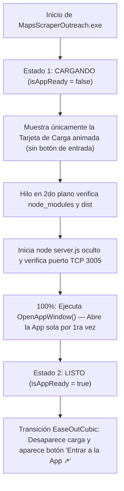

# Arquitectura y Diseño del Launcher (`Launcher.cs` / `MapsScraperOutreach.exe`)

Este documento detalla cómo está construido internamente el lanzador de escritorio nativo para Windows ([`Launcher.cs`](file:///c:/Users/lenov/Documents/antigravity/delightful-bell/Launcher.cs), compilado en [`MapsScraperOutreach.exe`](file:///c:/Users/lenov/Documents/antigravity/delightful-bell/MapsScraperOutreach.exe)), su motor de renderizado a **60 FPS**, sus **tokens visuales** sincronizados con la aplicación web y su **flujo de arranque automático**.

---

## 1. Visión General y Tecnología

En lugar de utilizar controles estándar de Windows Forms (que tienen bordes cuadrados y no soportan transparencias ni degradés radiales), [`MainForm`](file:///c:/Users/lenov/Documents/antigravity/delightful-bell/Launcher.cs#L13-L526) implementa un **lienzo personalizado acelerado con doble búfer (`DoubleBuffered` + GDI+ `System.Drawing.Drawing2D`)**:

- **Cero dependencias externas:** Se compila directamente con el compilador nativo de Windows (`csc.exe` de .NET Framework 4.x) usando únicamente `System.dll`, `System.Drawing.dll` y `System.Windows.Forms.dll`.
- **Renderizado vectorial antialiasing:** Activa `SmoothingMode.AntiAlias` y `TextRenderingHint.ClearTypeGridFit` en [`OnPaint`](file:///c:/Users/lenov/Documents/antigravity/delightful-bell/Launcher.cs#L204-L269) para lograr bordes tipo pastilla (`border-radius: 99px`), sombras difuminadas y tipografía nítida.
- **Bucle de animación a 60 FPS:** Un `Timer` (`animTimer`) con intervalo de `16 ms` ejecuta [`OnAnimationTick`](file:///c:/Users/lenov/Documents/antigravity/delightful-bell/Launcher.cs#L126-L144) para interpolar progresos, rotaciones, halos pulsantes y efectos hover/click sin parpadeos (`OptimizedDoubleBuffer`).

---

## 2. Flujo de Estados del Launcher

El launcher tiene dos estados principales en su zona central para evitar que el usuario intente abrir la app antes de que el servidor esté listo:



> [!IMPORTANT]
> Durante el **Estado 1 (`!isAppReady`)**, el área de clic del botón principal está deshabilitada en [`OnFormMouseMove`](file:///c:/Users/lenov/Documents/antigravity/delightful-bell/Launcher.cs#L157-L172) y [`OnFormMouseUp`](file:///c:/Users/lenov/Documents/antigravity/delightful-bell/Launcher.cs#L180-L202). El botón **`Entrar a la App ↗`** recién se habilita y aparece visualmente después de que [`OpenAppWindow()`](file:///c:/Users/lenov/Documents/antigravity/delightful-bell/Launcher.cs#L483-L512) lanza la ventana por primera vez.

---

## 3. Tokens de Diseño (Sincronizados con la App Web)

Los colores y proporciones están definidos como constantes estáticas en [`MainForm`](file:///c:/Users/lenov/Documents/antigravity/delightful-bell/Launcher.cs#L40-L62) para coincidir exactamente con el diseño claro perlado de la interfaz React:

| Token en `Launcher.cs` | Valor Hex / RGB | Uso en la Ventana |
| :--- | :--- | :--- |
| `ColBgBase` | `#fdfdff` | Fondo base claro de la ventana (`460 × 280 px`) |
| **Degradés Perlados** | Celeste, Lila, Durazno, Menta | 4 elipses radiales pintadas con `PathGradientBrush` en las esquinas |
| `ColTextPrimary` | `#1f1f1f` | Título principal y texto de la etapa de carga actual |
| `ColTextSecondary` | `#5f6368` | Subtítulo, etiqueta `"App local"` y descripción secundaria de carga |
| `ColPrimary` / `ColPrimaryHover` | `#1a73e8` / `#1765cc` | Botón pastilla principal `"Entrar a la App ↗"` y porcentaje |
| `ColTonal` / `ColOnTonal` | `#e8f0fe` / `#174ea6` | Insignia de puerto en carga y hover de `"Carpeta de Excels"` |
| `ColSuccess` / `ColSuccessBg` | `#1e8e3e` / `#e6f4ea` | Punto verde activo e insignia `"Activo · Puerto 3005"` |
| `ColDangerBg` / `ColDangerText` | `#fce8e6` / `#c5221f` | Botón `"Apagar Servidor"` en reposo (hover sólido en `#d93025`) |
| `GBlue`, `GRed`, `GYellow`, `GGreen` | `#4285f4`, `#ea4335`, `#fbbc04`, `#34a853` | Anillo giratorio de 4 arcos y barra de progreso multicolor |

### Tipografía (`DetectPreferredFont`)
Al iniciar, [`DetectPreferredFont()`](file:///c:/Users/lenov/Documents/antigravity/delightful-bell/Launcher.cs#L76-L88) detecta si la fuente **`Outfit`** está instalada en Windows; si no lo está, utiliza automáticamente **`Segoe UI`** con renderizado ClearType.

---

## 4. Desglose Visual Sección por Sección

### 4.1. Fondo Perlado (`DrawPearlescentGlow`)
En [`OnPaint`](file:///c:/Users/lenov/Documents/antigravity/delightful-bell/Launcher.cs#L214-L219), tras limpiar el lienzo con `#fdfdff`, [`DrawPearlescentGlow`](file:///c:/Users/lenov/Documents/antigravity/delightful-bell/Launcher.cs#L271-L282) dibuja cuatro resplandores suaves en las esquinas mediante `PathGradientBrush` con centro semitransparente y borde `alpha = 0`:
- **Arriba izquierda:** Celeste (`rgba(190, 215, 255, 0.27)`)
- **Arriba derecha:** Lila (`rgba(232, 205, 255, 0.23)`)
- **Abajo derecha:** Durazno (`rgba(255, 224, 214, 0.25)`)
- **Abajo izquierda:** Menta (`rgba(198, 244, 230, 0.23)`)

### 4.2. Barra de Estado Superior (`DrawTopBar`)
Ubicada en la franja superior (`Y = 14..38`), [`DrawTopBar`](file:///c:/Users/lenov/Documents/antigravity/delightful-bell/Launcher.cs#L284-L333) replica la barra superior de la web app:
- **Izquierda:** Un punto de `8 px` con un **halo expansivo pulsante** calculado con `Math.Sin(animTick * 2.2f)` + texto `"App local"`. Mientras carga es azul (`#1a73e8`) y al terminar pasa a verde (`#1e8e3e`).
- **Derecha:** Una insignia en forma de pastilla (`CreateRoundedRect`) que muestra `"Puerto 3005"` en azul tonal mientras carga y cambia a `"Activo · Puerto 3005"` en verde tonal cuando el servidor está listo.

### 4.3. Cabecera Central
- **Título (`Y = 54`):** `"Maps Scraper & WhatsApp"` centrado en `15.5pt Regular` (`#1f1f1f`).
- **Subtítulo dinámico (`Y = 84`):** Muestra `"Iniciando servicios locales automáticamente..."` durante la carga, y cambia a `"Servidor local sincronizado · Listo para usar"` una vez abierta la app.

### 4.4. Zona Central Dinámica (`Y = 122..186`)

#### A) Modo Carga (`DrawLoadingCard`)
Mientras `isAppReady == false`, [`DrawLoadingCard`](file:///c:/Users/lenov/Documents/antigravity/delightful-bell/Launcher.cs#L335-L426) dibuja una tarjeta flotante blanca (`border-radius: 24px`) con sombra suave y borde `#dadce0` que contiene:
1. **Spinner de 4 colores de Google:** Cuatro arcos de `68°` (`LineCap.Round`) pintados en azul, rojo, amarillo y verde que giran continuamente (`baseAngle = (animTick * 150f) % 360f`).
2. **Texto de etapa principal (`loadingStepText`)** y **subtexto explicativo (`loadingSubText`)**.
3. **Porcentaje en vivo (`5%` a `100%`)** alineado a la derecha en color `#1a73e8`.
4. **Barra de progreso inferior de 4 colores:** Pista redondeada de `4 px` rellena con un `LinearGradientBrush` + `ColorBlend` de los 4 tonos de Google, cuyo ancho se interpola suavemente (`displayProgress += (targetProgress - displayProgress) * 0.12f`).

#### B) Modo Listo (`DrawOpenAppButton`)
Cuando la app se abre por primera vez (`isAppReady = true`), la variable `readyReveal` avanza de `0.0` a `1.0` aplicando una curva cúbica (`EaseOutCubic`):
- La tarjeta de carga se desvanece y se desliza hacia arriba.
- En su lugar emerge [`DrawOpenAppButton`](file:///c:/Users/lenov/Documents/antigravity/delightful-bell/Launcher.cs#L428-L460): un botón pastilla (`border-radius: 54px`) en azul `#1a73e8` con sombra difuminada azulada y texto **`"Entrar a la App   ↗"`**.
- Al pasar el mouse por encima (`hoverOpenApp`), el botón interpola su color hacia `#1765cc`, intensifica su sombra y se eleva `-2 px`.

### 4.5. Botones Inferiores de Control (`DrawSecondaryPillButton`)
Ubicados en `Y = 206` y mantenidos visibles en todo momento mediante [`DrawSecondaryPillButton`](file:///c:/Users/lenov/Documents/antigravity/delightful-bell/Launcher.cs#L462-L505):
1. **`📂 Carpeta de Excels` (Izquierda):**
   - Superficie blanca con borde `#dadce0` que al hacer hover se tiñe de azul tonal (`#e8f0fe` / `#174ea6`).
   - Al hacer clic ejecuta [`OpenExcelsFolder()`](file:///c:/Users/lenov/Documents/antigravity/delightful-bell/Launcher.cs#L194-L202), que abre `C:\Users\lenov\Documents\antigravity\delightful-bell\excels` directamente en el Explorador de Windows (`explorer.exe`).
2. **`⏹ Apagar Servidor` (Derecha):**
   - Superficie roja tonal suave (`#fce8e6` con texto `#c5221f`) que al hacer hover pasa a rojo intenso (`#d93025`) con texto blanco.
   - Al hacer clic cierra la ventana y ejecuta [`OnFormClosing`](file:///c:/Users/lenov/Documents/antigravity/delightful-bell/Launcher.cs#L514-L526), terminando el proceso `node server.js` en segundo plano.

---

## 5. Secuencia de Arranque en Segundo Plano (`StartBackendAndOpen`)

Al mostrarse la ventana ([`OnFormShown`](file:///c:/Users/lenov/Documents/antigravity/delightful-bell/Launcher.cs#L528-L531)), se lanza [`StartBackendAndOpen()`](file:///c:/Users/lenov/Documents/antigravity/delightful-bell/Launcher.cs#L556-L645) en un hilo del `ThreadPool` para mantener las animaciones a 60 FPS sin bloqueos:

1. **Etapa 1 (`22%`) — `"Verificando entorno y archivos locales..."`:**
   - Comprueba si existen las carpetas `node_modules` y `frontend/dist/index.html`.
2. **Etapa 2 (`38%`, condicional) — `"Instalando dependencias por única vez..."`:**
   - Si es la primera vez que se corre en una PC nueva y faltan módulos, ejecuta `Instalador_Primera_Vez.bat` y espera a que termine.
3. **Etapa 3 (`62% -> 88%`) — `"Iniciando servidor y motor de Google Maps..."`:**
   - Verifica con [`IsPortOpen(3005)`](file:///c:/Users/lenov/Documents/antigravity/delightful-bell/Launcher.cs#L533-L550) si el servidor ya está escuchando.
   - Si no está activo, inicia `node server.js` de forma completamente invisible (`CreateNoWindow = true`, `WindowStyle = Hidden`) y sondea el puerto cada `250 ms` incrementando la barra de progreso.
4. **Etapa 4 (`100%`) — `"¡Todo listo! Abriendo la aplicación..."`:**
   - Llama a [`OpenAppWindow()`](file:///c:/Users/lenov/Documents/antigravity/delightful-bell/Launcher.cs#L647-L676), que busca Microsoft Edge o Google Chrome para abrir `http://localhost:3005` en modo ventana de aplicación dedicada (`--app=http://localhost:3005 --window-size=1360,860`).
   - Tras `300 ms`, cambia `isAppReady = true`, disparando la transición que revela el botón **`Entrar a la App ↗`**.

---

## 6. Cómo Recompilar `MapsScraperOutreach.exe`

Si en el futuro modificas [`Launcher.cs`](file:///c:/Users/lenov/Documents/antigravity/delightful-bell/Launcher.cs), puedes recompilar el ejecutable en 1 segundo desde PowerShell sin instalar Visual Studio ejecutando:

```powershell
& "C:\Windows\Microsoft.NET\Framework64\v4.0.30319\csc.exe" /target:winexe /out:MapsScraperOutreach.exe /r:System.dll /r:System.Drawing.dll /r:System.Windows.Forms.dll Launcher.cs
```
