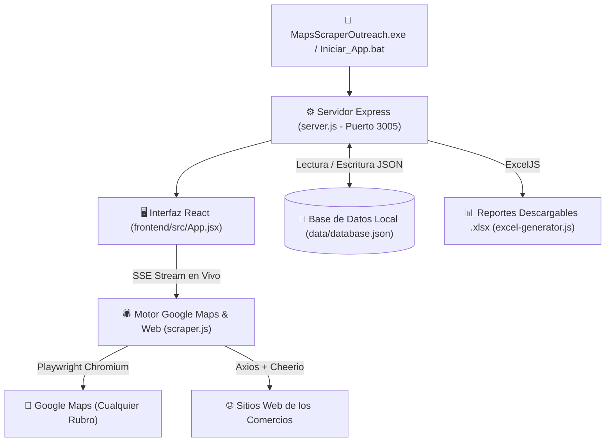

# 📐 Arquitectura y Desglose Sección por Sección — Maps Scraper & WhatsApp Outreach

Este documento detalla cómo está construida la aplicación **Maps Scraper & WhatsApp Outreach**, desglosando tanto las **secciones visuales de la interfaz** como las **capas internas del motor de scrapeo, base de datos local, generador de Excel y ejecutable `.exe`**.

---

## 🗺️ 1. Mapa General de la Arquitectura

La aplicación funciona **100% en local** bajo una arquitectura cliente-servidor unificada en el puerto `3005`, sin depender de bases de datos externas ni servicios pagos:

| Archivo Principal | Rol en el Sistema |
| :--- | :--- |
| [MapsScraperOutreach.exe](file:///c:/Users/lenov/Documents/antigravity/delightful-bell/MapsScraperOutreach.exe) / [Launcher.cs](file:///c:/Users/lenov/Documents/antigravity/delightful-bell/Launcher.cs) | Lanzador nativo de Windows que verifica el puerto `3005`, inicia el backend en segundo plano y abre el navegador automáticamente. |
| [server.js](file:///c:/Users/lenov/Documents/antigravity/delightful-bell/server.js) | Servidor HTTP + API REST + Streaming SSE en tiempo real + persistencia en disco (`data/database.json`). |
| [scraper.js](file:///c:/Users/lenov/Documents/antigravity/delightful-bell/scraper.js) | Motor de extracción universal en Google Maps con Playwright + rastreador de redes sociales/emails en sitios web + normalizador de teléfonos para WhatsApp. |
| [excel-generator.js](file:///c:/Users/lenov/Documents/antigravity/delightful-bell/excel-generator.js) | Generador de archivos `.xlsx` multi-pestaña con formato profesional, hipervínculos clicables y autoajuste de columnas. |
| [frontend/src/App.jsx](file:///c:/Users/lenov/Documents/antigravity/delightful-bell/frontend/src/App.jsx) | Aplicación de interfaz de usuario dividida en **2 grandes vistas** y múltiples sub-secciones interactivas. |

---

## 🖥️ 2. Desglose de la Interfaz (Sección por Sección)

Toda la interfaz gráfica está implementada en [frontend/src/App.jsx](file:///c:/Users/lenov/Documents/antigravity/delightful-bell/frontend/src/App.jsx) y se organiza en **una barra de navegación superior fija** y **dos vistas principales** conmutables sin recargar la página.

### 🔹 Sección A: Barra de Navegación Superior (`Header`)
📍 **Código:** [App.jsx (Líneas 533-595)](file:///c:/Users/lenov/Documents/antigravity/delightful-bell/frontend/src/App.jsx#L533-L595)
- **Identidad y Estado:** Muestra el logo de la aplicación y el indicador `App Local`.
- **Selector de Vistas Principales (`mainView`):**
  1. **Buscador Google Maps (`scraper`):** Muestra un indicador luminoso animado cuando hay una extracción corriendo en segundo plano.
  2. **Mis Secciones & WhatsApp Outreach (`outreach`):** Incluye un contador en tiempo real con la cantidad total de **secciones creadas** y el **total de contactos almacenados** (`{sections.length} secc. / {totalStoredContacts}`).

---

### 🔹 Sección B: Vista 1 — Buscador Universal de Google Maps (`mainView === 'scraper'`)
📍 **Código:** [App.jsx (Líneas 600-1115)](file:///c:/Users/lenov/Documents/antigravity/delightful-bell/frontend/src/App.jsx#L600-L1115)

Esta vista se divide en **2 columnas** (4 columnas a la izquierda para control y consola; 8 columnas a la derecha para métricas y tabla en vivo):

#### 1. Panel de Configuración de Búsqueda (Columna Izquierda Superior)
📍 **Código:** [App.jsx (Líneas 604-830)](file:///c:/Users/lenov/Documents/antigravity/delightful-bell/frontend/src/App.jsx#L604-L830)
- **Buscador libre de cualquier comercio:** Input de texto para escribir cualquier rubro y zona (ej. *"Ferreterías en Caballito"*, *"Gimnasios en Palermo"*, *"Restaurantes en Córdoba"*), acompañado de **botones de ejemplos rápidos** ([Líneas 633-648](file:///c:/Users/lenov/Documents/antigravity/delightful-bell/frontend/src/App.jsx#L633-L648)).
- **Selector de Espacio / Sección de Destino:** ([Líneas 651-689](file:///c:/Users/lenov/Documents/antigravity/delightful-bell/frontend/src/App.jsx#L651-L689))
  - Permite **crear una sección nueva dedicada** automáticamente para la búsqueda (con nombre personalizado opcional o tomando el nombre de la búsqueda).
  - O bien **acumular los nuevos resultados dentro de una sección existente** seleccionada de la lista desplegable.
- **Selector de País para WhatsApp:** ([Líneas 691-709](file:///c:/Users/lenov/Documents/antigravity/delightful-bell/frontend/src/App.jsx#L691-L709)) Permite elegir el prefijo internacional (`+54` Argentina, `+55` Brasil, `+52` México, `+34` España, `+56` Chile, `+57` Colombia, `+598` Uruguay, etc.) para convertir los teléfonos fijos/celulares de Google Maps en enlaces `https://wa.me/...` válidos.
- **Modo Búsqueda Continua (Infinita) vs. Límite Fijo:** ([Líneas 711-756](file:///c:/Users/lenov/Documents/antigravity/delightful-bell/frontend/src/App.jsx#L711-L756))
  - Permite definir un número exacto de comercios (ej. `25`) o activar **Búsqueda Continua (Sin límite)** para que recorra Google Maps indefinidamente hasta que el usuario presione **"Detener y Guardar Recopilados"**.
- **Modo de Ventana del Navegador (`headful`):** ([Líneas 758-776](file:///c:/Users/lenov/Documents/antigravity/delightful-bell/frontend/src/App.jsx#L758-L776)) Permite alternar entre navegador **Oculto (Headless, más rápido)** o **Visible** (abre la ventana de Chromium para ver cómo navega Google Maps en vivo).
- **Botones de Acción y Descarga:** ([Líneas 778-829](file:///c:/Users/lenov/Documents/antigravity/delightful-bell/frontend/src/App.jsx#L778-L829))
  - **Iniciar Búsqueda / Detener y Guardar:** Inicia o corta el stream SSE en cualquier momento sin perder lo recopilado.
  - **Descargar Excel:** Descarga inmediatamente el archivo `.xlsx` generado con los resultados de la búsqueda.
  - **Ver en WhatsApp Outreach:** Salta directamente a la sección dedicada recién creada en la vista de Outreach.

#### 2. Consola de Scrapeo en Vivo (Columna Izquierda Inferior)
📍 **Código:** [App.jsx (Líneas 832-863)](file:///c:/Users/lenov/Documents/antigravity/delightful-bell/frontend/src/App.jsx#L832-L863)
- Terminal en tiempo real que recibe los logs vía **Server-Sent Events (SSE)** desde el backend.
- Colorea automáticamente los eventos según su tipo: información (azul), comercio extraído con éxito (verde esmeralda), advertencias (ámbar) o errores (rojo), haciendo auto-scroll hacia abajo a medida que avanza.

#### 3. Tarjetas de Métricas en Vivo (Columna Derecha Superior)
📍 **Código:** [App.jsx (Líneas 868-914)](file:///c:/Users/lenov/Documents/antigravity/delightful-bell/frontend/src/App.jsx#L868-L914)
- Muestra 5 contadores dinámicos a medida que entran los comercios:
  1. **Recopilados:** Total de comercios extraídos.
  2. **Con Tel / WA:** Comercios con número listo para enviar WhatsApp.
  3. **Con Web Propia:** Comercios con dominio web propio activo.
  4. **Con Redes:** Comercios a los que se les detectó Instagram, Facebook, TikTok o LinkedIn.
  5. **Sin Sitio Web:** Comercios que solo están en Maps o solo tienen una red social (ideales como oportunidad comercial).

#### 4. Tabla de Vista Previa y Filtros Rápidos (Columna Derecha Inferior)
📍 **Código:** [App.jsx (Líneas 937-1112)](file:///c:/Users/lenov/Documents/antigravity/delightful-bell/frontend/src/App.jsx#L937-L1112)
- Incluye pestañas de filtrado en vivo (`Todos`, `Con Teléfono/WhatsApp`, `Con Web Propia`, `Con Redes`, `Sin Sitio Web`) y una tabla donde van apareciendo los comercios segundo a segundo mientras se guardan en su sección.

---

### 🔹 Sección C: Vista 2 — Mis Secciones & WhatsApp Outreach (`mainView === 'outreach'`)
📍 **Código:** [App.jsx (Líneas 1120-1774)](file:///c:/Users/lenov/Documents/antigravity/delightful-bell/frontend/src/App.jsx#L1120-L1774)

Esta vista es el centro de almacenamiento y contacto por WhatsApp. Está estructurada en **un panel lateral izquierdo de secciones** (3 columnas) y **un área principal derecha con la grilla de tarjetas de contacto** (9 columnas):

#### 1. Barra Lateral de Secciones Dedicadas (`Aside`)
📍 **Código:** [App.jsx (Líneas 1123-1261)](file:///c:/Users/lenov/Documents/antigravity/delightful-bell/frontend/src/App.jsx#L1123-L1261)
- Lista todas las búsquedas guardadas como **espacios independientes** (ordenadas de más reciente a más antigua).
- Cada tarjeta de sección muestra:
  - Nombre de la sección y fecha/hora de creación.
  - Barra de progreso de contactados (`contactados / total` y porcentaje `%`).
  - **3 botones de gestión por sección:**
    1. ✏️ **Renombrar sección** ([`handleRenameSection`](file:///c:/Users/lenov/Documents/antigravity/delightful-bell/frontend/src/App.jsx#L377-L397)).
    2. 📥 **Descargar Excel `.xlsx` exclusivo de esa sección** ([`handleDownloadSectionExcel`](file:///c:/Users/lenov/Documents/antigravity/delightful-bell/frontend/src/App.jsx#L328-L349)).
    3. 🗑️ **Borrar la sección entera** con todos sus contactos ([`handleDeleteSection`](file:///c:/Users/lenov/Documents/antigravity/delightful-bell/frontend/src/App.jsx#L352-L374)).
- Incluye además un botón superior (`+`) para crear secciones vacías manualmente.

#### 2. Cabecera de la Sección Activa y Editor de Plantilla de WhatsApp
📍 **Código:** [App.jsx (Líneas 1281-1418)](file:///c:/Users/lenov/Documents/antigravity/delightful-bell/frontend/src/App.jsx#L1281-L1418)
- Muestra el título de la sección seleccionada, la búsqueda original de Google Maps y botones rápidos para **Configurar Mensaje WhatsApp**, **Descargar Excel de la sección** o **Borrar Sección Entera**.
- **Editor Desplegable de Plantilla de WhatsApp:** ([Líneas 1330-1380](file:///c:/Users/lenov/Documents/antigravity/delightful-bell/frontend/src/App.jsx#L1330-L1380))
  - Permite redactar el mensaje predeterminado usando variables dinámicas con botones de inserción rápida: `{nombre}`, `{rubro}`, `{lugar}` y `{web}`.
  - Se guarda automáticamente en la base de datos local al editarlo.
- **Buscador Interno y Filtros de Estado:** ([Líneas 1382-1417](file:///c:/Users/lenov/Documents/antigravity/delightful-bell/frontend/src/App.jsx#L1382-L1417))
  - Permite buscar por texto dentro de la sección (nombre, rubro, dirección o teléfono) y filtrar por: `Todos`, `⏳ Pendientes`, `✅ Contactados`, `📞 Con Teléfono`, `🌐 Con Web` o `🚀 Sin Web`.

#### 3. Grilla de Tarjetas de Contacto con Botones Interactivos
📍 **Código:** [App.jsx (Líneas 1423-1770)](file:///c:/Users/lenov/Documents/antigravity/delightful-bell/frontend/src/App.jsx#L1423-L1770)

Cada comercio dentro de la sección se representa como una **tarjeta moderna en una grilla de 2 columnas** que contiene:
1. **Encabezado del Comercio y Borrado Individual:** ([Líneas 1451-1489](file:///c:/Users/lenov/Documents/antigravity/delightful-bell/frontend/src/App.jsx#L1451-L1489))
   - Nombre del negocio, etiqueta de rubro/categoría, estrellas de calificación y cantidad de reseñas, insignia de `Contactado` y el **botón de papelera (`Trash2`) para borrar ese contacto individual** de la sección sin afectar al resto ([`handleDeleteContact`](file:///c:/Users/lenov/Documents/antigravity/delightful-bell/frontend/src/App.jsx#L419-L436)).
2. **Grilla 2x2 de Botones de Datos del Comercio:** ([Líneas 1494-1688](file:///c:/Users/lenov/Documents/antigravity/delightful-bell/frontend/src/App.jsx#L1494-L1688))
   - 📍 **Botón 1 — Lugar / Maps:** Muestra la dirección física y al hacer clic abre la ubicación exacta en Google Maps en una pestaña nueva.
   - 📞 **Botón 2 — N° de Contacto:** Muestra el teléfono formateado y al hacer clic **lo copia al portapapeles** con confirmación visual (`¡Copiado!`).
   - 🌐 **Botón 3 — Página Web:** Si tiene web propia, abre el sitio web en una nueva pestaña; si no tiene, muestra una etiqueta ámbar indicando `Sin Sitio Web Propio`.
   - 📸 **Botón 4 — Redes & Canales:** Muestra botones individuales clicables para cada red social encontrada (**Instagram**, **Facebook**, **TikTok**, **LinkedIn**, **X/Twitter**) y un botón para copiar el **Email** si fue detectado.
3. **Vista Previa y Personalización del Mensaje de WhatsApp:** ([Líneas 1690-1720](file:///c:/Users/lenov/Documents/antigravity/delightful-bell/frontend/src/App.jsx#L1690-L1720))
   - Muestra cómo queda el mensaje personalizado con los datos de ese comercio específico y permite pulsar **"Personalizar texto"** para modificar el mensaje de ese único comercio antes de enviarlo.
4. **Pie de Tarjeta — Botón de Envío de WhatsApp y Estado:** ([Líneas 1723-1765](file:///c:/Users/lenov/Documents/antigravity/delightful-bell/frontend/src/App.jsx#L1723-L1765))
   - **Botón `Enviar WhatsApp`:** Abre `https://wa.me/<numero>?text=<mensaje>` directamente en WhatsApp Web o la App de Escritorio y **marca automáticamente al comercio como "Contactado"**.
   - **Botón `Marcar` / `Contactado`:** Permite marcar o desmarcar manualmente si un comercio ya fue contactado.

---

## 🕷️ 3. Motor de Scrapeo Universal ([scraper.js](file:///c:/Users/lenov/Documents/antigravity/delightful-bell/scraper.js))

El archivo [scraper.js](file:///c:/Users/lenov/Documents/antigravity/delightful-bell/scraper.js) contiene tres subsistemas principales:

1. **Normalizador Inteligente de Teléfonos para WhatsApp ([`normalizeWhatsAppPhone`](file:///c:/Users/lenov/Documents/antigravity/delightful-bell/scraper.js#L16-L78)):**
   - Limpia caracteres invisibles e íconos Unicode de Google Maps ([`cleanGlyphs`](file:///c:/Users/lenov/Documents/antigravity/delightful-bell/scraper.js#L8-L11)).
   - Si el sitio web del comercio ya tenía un link `wa.me/`, extrae el número directo de ahí.
   - Adapta números locales según el país elegido (por ejemplo, en Argentina `+54`, quita el `0` inicial del código de área, quita el `15` intermedio y antepone `549` para que WhatsApp lo reconozca como móvil válido).
2. **Rastreador Profundo de Sitios Web y Redes Sociales ([`scrapeWebsiteContacts`](file:///c:/Users/lenov/Documents/antigravity/delightful-bell/scraper.js#L156-L310)):**
   - Clasifica si el enlace web cargado en Google Maps es un dominio propio o si apunta directamente a una red social (`instagram.com`, `facebook.com`, `wa.me`, `tiktok.com`, `linkedin.com`, `x.com`) mediante [`classifyWebsiteUrl`](file:///c:/Users/lenov/Documents/antigravity/delightful-bell/scraper.js#L141-L151).
   - Si es un sitio web propio, descarga el HTML principal y hasta 2 subpáginas de `/contacto` o `/nosotros` usando `axios` y `cheerio`.
   - Desencripta emails protegidos por Cloudflare ([`decryptCloudflareEmail`](file:///c:/Users/lenov/Documents/antigravity/delightful-bell/scraper.js#L124-L136)), extrae enlaces `mailto:`, valida correos reales descartando falsos positivos ([`validateEmail`](file:///c:/Users/lenov/Documents/antigravity/delightful-bell/scraper.js#L94-L119)) y captura todos los enlaces a **Instagram, Facebook, WhatsApp, TikTok, LinkedIn y X/Twitter**.
3. **Navegador Automatizado de Google Maps ([`scrapeGoogleMaps`](file:///c:/Users/lenov/Documents/antigravity/delightful-bell/scraper.js#L315-L754)):**
   - Lanza Chromium con `playwright`, acepta cookies si aparecen, ejecuta la búsqueda en `google.com/maps/search/...` y hace scroll automático sobre el panel lateral (`div[role="feed"]`) hasta alcanzar la cantidad pedida o el final de la lista.
   - Abre cada comercio y extrae: **Nombre, Rubro/Categoría, Dirección/Lugar, Teléfono, Sitio Web, Calificación (Rating), Cantidad de Reseñas y URL exacta del lugar en Google Maps**.

---

## ⚙️ 4. Servidor Backend y Base de Datos Local ([server.js](file:///c:/Users/lenov/Documents/antigravity/delightful-bell/server.js))

El archivo [server.js](file:///c:/Users/lenov/Documents/antigravity/delightful-bell/server.js) gestiona tanto la persistencia en disco como los endpoints de la API:

- **Persistencia Local ([`readDb`](file:///c:/Users/lenov/Documents/antigravity/delightful-bell/server.js#L39-L55) y [`writeDb`](file:///c:/Users/lenov/Documents/antigravity/delightful-bell/server.js#L57-L63)):**
  - Lee y guarda automáticamente en [data/database.json](file:///c:/Users/lenov/Documents/antigravity/delightful-bell/data/database.json) la lista de secciones, todos los contactos dentro de cada sección y la configuración global (plantilla de WhatsApp y código de país).
  - Evita duplicados dentro de una misma sección comparando nombre y teléfono al agregar resultados en vivo ([Líneas 331-355](file:///c:/Users/lenov/Documents/antigravity/delightful-bell/server.js#L331-L355)).

### Endpoints de la API Local:
| Método y Ruta | Función | Línea en `server.js` |
| :--- | :--- | :--- |
| `GET /api/sections` | Obtiene todas las secciones guardadas y la configuración global. | [Línea 71](file:///c:/Users/lenov/Documents/antigravity/delightful-bell/server.js#L71-L78) |
| `POST /api/sections` | Crea una nueva sección manualmente. | [Línea 83](file:///c:/Users/lenov/Documents/antigravity/delightful-bell/server.js#L83-L105) |
| `PUT /api/sections/:sectionId` | Renombra una sección existente. | [Línea 110](file:///c:/Users/lenov/Documents/antigravity/delightful-bell/server.js#L110-L127) |
| `DELETE /api/sections/:sectionId` | **Borra una sección entera** y todos sus contactos. | [Línea 132](file:///c:/Users/lenov/Documents/antigravity/delightful-bell/server.js#L132-L144) |
| `DELETE /api/sections/:sectionId/contacts/:contactId` | **Borra un contacto individual** dentro de una sección. | [Línea 149](file:///c:/Users/lenov/Documents/antigravity/delightful-bell/server.js#L149-L168) |
| `PATCH /api/sections/:sectionId/contacts/:contactId` | Marca/desmarca un contacto como `contacted` o actualiza su teléfono/notas. | [Línea 173](file:///c:/Users/lenov/Documents/antigravity/delightful-bell/server.js#L173-L206) |
| `POST /api/sections/:sectionId/export-excel` | Genera un archivo Excel `.xlsx` con los contactos de esa sección. | [Línea 211](file:///c:/Users/lenov/Documents/antigravity/delightful-bell/server.js#L211-L234) |
| `PUT /api/settings` | Guarda la plantilla de mensaje de WhatsApp y el código de país. | [Línea 239](file:///c:/Users/lenov/Documents/antigravity/delightful-bell/server.js#L239-L252) |
| `GET /api/scrape-stream` | Inicia el scrapeo en tiempo real por SSE, guardando cada contacto en su sección a medida que se extrae. | [Línea 258](file:///c:/Users/lenov/Documents/antigravity/delightful-bell/server.js#L258-L418) |
| `GET /api/download/:filename` | Descarga el archivo Excel `.xlsx` generado desde la carpeta `temp/`. | [Línea 454](file:///c:/Users/lenov/Documents/antigravity/delightful-bell/server.js#L454-L473) |

---

## 📊 5. Generador de Excel Multi-Pestaña ([excel-generator.js](file:///c:/Users/lenov/Documents/antigravity/delightful-bell/excel-generator.js))

Cuando termina una búsqueda o cuando presionás **"Descargar Excel"** en cualquier sección, [excel-generator.js](file:///c:/Users/lenov/Documents/antigravity/delightful-bell/excel-generator.js) construye un libro `.xlsx` con **4 hojas separadas y coloreadas**:

1. **🟦 Pestaña 1 — `Todos los Comercios`:** Lista completa de todos los negocios de la búsqueda.
2. **🟩 Pestaña 2 — `Con WhatsApp y Teléfono`:** Filtra únicamente los comercios que tienen número telefónico o enlace de WhatsApp listo para contactar.
3. **🟦 Pestaña 3 — `Con Sitio Web Propio`:** Negocios que cuentan con un dominio web propio activo.
4. **🟧 Pestaña 4 — `Sin Sitio Web (Oportunidad)`:** Negocios que solo aparecen en Google Maps o solo tienen Instagram/Facebook pero carecen de página web propia.

Cada hoja incluye **16 columnas** (Comercio, Rubro, Lugar/Dirección, Número de Contacto, Link WhatsApp, Página Web, Instagram, Facebook, TikTok/LinkedIn, Email, Presencia Digital, Rating, Reseñas, Ubicación Google Maps, Estado WhatsApp y Fecha), con fila superior inmovilizada y enlaces convertidos automáticamente en hipervínculos clicables ([Líneas 18-57](file:///c:/Users/lenov/Documents/antigravity/delightful-bell/excel-generator.js#L18-L57)).

---

## 🚀 6. Ejecutable `.exe` e Instaladores para Otra PC

Para que la aplicación corra como un programa de escritorio en tu PC o en cualquier otra computadora con Windows:

- **[Launcher.cs](file:///c:/Users/lenov/Documents/antigravity/delightful-bell/Launcher.cs) $\rightarrow$ Compilado en [MapsScraperOutreach.exe](file:///c:/Users/lenov/Documents/antigravity/delightful-bell/MapsScraperOutreach.exe):**
  - Verifica si el puerto `3005` ya está activo en la PC.
  - Si no está activo, levanta `node server.js` de forma oculta en segundo plano, espera a que el servidor responda y abre `http://localhost:3005` en el navegador predeterminado.
- **[Instalador_Primera_Vez.bat](file:///c:/Users/lenov/Documents/antigravity/delightful-bell/Instalador_Primera_Vez.bat):**
  - Script que se ejecuta una única vez en una PC nueva para instalar paquetes (`npm install`), descargar el motor Chromium de Playwright (`npx playwright install chromium`), compilar el frontend (`npm run build`) y regenerar el `.exe` si fuera necesario.
